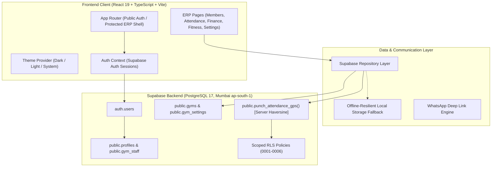

# Production Database Integration, Security Hardening & Authentication Plan

> **For agentic workers:** REQUIRED SUB-SKILL: Use superpowers:executing-plans to implement this plan task-by-task. Steps use checkbox (`- [ ]`) syntax for tracking.

**Goal:** Transform GymOS into a fully database-integrated, hardened commercial ERP with dual-theme (dark/light) enterprise UI, real Supabase authentication, server-validated GPS geofencing, and corrected RLS policies.

**Architecture:** 
1. Database: PostgreSQL 17 corrective migration `0006` closing RLS vulnerabilities on workout exercises, diet meals, and audit logs, plus adding a server-side `punch_attendance_gps` security-definer function.
2. Theme: Dynamic CSS-variable theme engine supporting dark mode, elegant light mode, and automatic OS device adaptation (`system`) with a 1-click toggle.
3. Auth: Real Supabase Auth workflows for Gym Owner registration, member login, password reset, and authenticated session management.
4. Repository: Asynchronous Supabase data layer with resilient offline fallback for continuous operation.
5. Verification: Comprehensive automated test suite with full Vitest coverage, production Vite build, and Vercel SPA configuration.

**Architecture Diagram:**

**Tech Stack:** React 19, TypeScript 5.7, Vite 6, Tailwind CSS 3.4, `@supabase/supabase-js` 2.49, Vitest 3.0, Lucide Icons.

**Spec:** [docs/PRD.md](file:///c:/Users/hp/OneDrive/Desktop/antigravity%20workspace/GYM_OS/docs/PRD.md), [docs/ARCHITECTURE.md](file:///c:/Users/hp/OneDrive/Desktop/antigravity%20workspace/GYM_OS/docs/ARCHITECTURE.md), and [docs/PRODUCTION_READINESS_AUDIT.md](file:///c:/Users/hp/OneDrive/Desktop/antigravity%20workspace/GYM_OS/docs/PRODUCTION_READINESS_AUDIT.md).

---

## Global Constraints

- Roles must strictly remain `gym_owner` and `member` (plus `platform_super_admin` for SaaS operations).
- Insecure demo role-switching must be removed in production and replaced with authenticated session profiles.
- Migration `0006` must correct all permissive RLS policies without altering previously committed migrations `0001`–`0005`.
- The theme engine must support Dark, Light, and System modes with high contrast and enterprise-grade typography.
- All code must pass strict TypeScript checks (`tsc --noEmit`) and Vitest test suites.

## Review Focus

1. **RLS Policy Safety:** `workout_exercises`, `diet_meals`, and `audit_logs` must be strictly scoped to the tenant gym staff.
2. **Server-Side GPS Validation:** `punch_attendance_gps` calculates distance on the server using authoritative gym coordinates and rejects spoofed client distances.
3. **Session Persistence & Role Guarding:** Unauthenticated users are redirected to `/login`; authenticated owners cannot access other gyms' data.
4. **Light Theme Contrast:** Text and borders in light mode must maintain WCAG AA contrast (charcoal slate `#0F172A` on `#FFFFFF` / `#F8FAFC`).
5. **No Broken CTAs:** Every button, modal trigger, export, and form submission must either perform its real action or display clear validation feedback.

---

## Implementation Tasks

### Task 1: Migration 0006 — Security Hardening & Server-Side GPS RPC

**Files:**
- Create: `supabase/migrations/0006_security_hardening_and_rpc.sql`
- Create: `tests/security/migration_security.test.ts`

- [ ] **Step 1: Write failing test verifying RLS policy restrictions and RPC function signature**
- [ ] **Step 2: Run test to verify it fails**
- [ ] **Step 3: Implement `0006_security_hardening_and_rpc.sql` with scoped RLS and `punch_attendance_gps` RPC**
- [ ] **Step 4: Run tests and verify PASS**
- [ ] **Step 5: Commit changes**

### Task 2: Theme Engine (Dark, Light, and System Device Adaptation)

**Files:**
- Create: `src/lib/theme/context.tsx`
- Modify: `src/index.css`
- Modify: `src/components/layout/Header.tsx`
- Modify: `src/components/layout/Sidebar.tsx`
- Modify: `src/components/ui/Card.tsx`
- Modify: `src/components/ui/Input.tsx`

- [ ] **Step 1: Write failing unit test for Theme Provider persistence and system preference detection**
- [ ] **Step 2: Run test to verify it fails**
- [ ] **Step 3: Implement Theme Context and CSS custom properties in `src/index.css`**
- [ ] **Step 4: Add theme toggle button (Sun/Moon/Laptop) to Header and Sidebar**
- [ ] **Step 5: Adapt UI components (Card, Input, Modal, Sidebar) for clean light-mode contrast**
- [ ] **Step 6: Run tests and verify PASS**
- [ ] **Step 7: Commit changes**

### Task 3: Supabase Authentication, Onboarding & Protected Routes

**Files:**
- Create: `src/lib/auth/context.tsx`
- Create: `src/components/auth/AuthGuard.tsx`
- Create: `src/pages/Login.tsx`
- Create: `src/pages/RegisterOwner.tsx`
- Create: `src/pages/ForgotPassword.tsx`
- Modify: `src/app/router.tsx`

- [ ] **Step 1: Write failing unit test for Auth Context sign-in, sign-up, and session handling**
- [ ] **Step 2: Run test to verify it fails**
- [ ] **Step 3: Implement `src/lib/auth/context.tsx` and `AuthGuard.tsx`**
- [ ] **Step 4: Implement Login, RegisterOwner (with gym slug generator and initial setup), and ForgotPassword pages**
- [ ] **Step 5: Update `AppRouter` with public auth routes and protected ERP routes**
- [ ] **Step 6: Run tests and verify PASS**
- [ ] **Step 7: Commit changes**

### Task 4: Supabase Live Database Repository & Resilient State Sync

**Files:**
- Create: `src/lib/supabase/repository.ts`
- Modify: `src/lib/supabase/store.ts`
- Modify: `src/lib/tenant/context.tsx`

- [ ] **Step 1: Write failing unit test for Supabase repository data fetching and sync**
- [ ] **Step 2: Run test to verify it fails**
- [ ] **Step 3: Implement `src/lib/supabase/repository.ts` with typed PostgREST queries**
- [ ] **Step 4: Connect `TenantProvider` to repository with automatic fallback to local store**
- [ ] **Step 5: Run tests and verify PASS**
- [ ] **Step 6: Commit changes**

### Task 5: Frontend CTA Audit & Module Hardening

**Files:**
- Modify: `src/pages/Dashboard.tsx`
- Modify: `src/pages/Members.tsx`
- Modify: `src/pages/Attendance.tsx`
- Modify: `src/pages/Finance.tsx`
- Modify: `src/pages/Settings.tsx`
- Modify: `src/pages/MemberPortal.tsx`

- [ ] **Step 1: Audit and verify all CTA buttons across all pages (no unhandled onclicks, no console warnings)**
- [ ] **Step 2: Verify responsive design at 1440px, 1280px, 768px, and 390px**
- [ ] **Step 3: Ensure member self-service portal is strictly isolated to the logged-in member**
- [ ] **Step 4: Commit changes**

### Task 6: Full Verification, Documentation & Remote Deployment Prep

**Files:**
- Create: `docs/FINAL_PRODUCTION_READINESS_REPORT.md`
- Create: `.env.example`
- Modify: `README.md`

- [ ] **Step 1: Run complete Vitest test suite (`npm run test`)**
- [ ] **Step 2: Run TypeScript compiler check (`tsc --noEmit`)**
- [ ] **Step 3: Run production build (`npm run build`)**
- [ ] **Step 4: Author `docs/FINAL_PRODUCTION_READINESS_REPORT.md`**
- [ ] **Step 5: Push milestone commit to GitHub (`https://github.com/sumit07122/GYM-OS`)**
