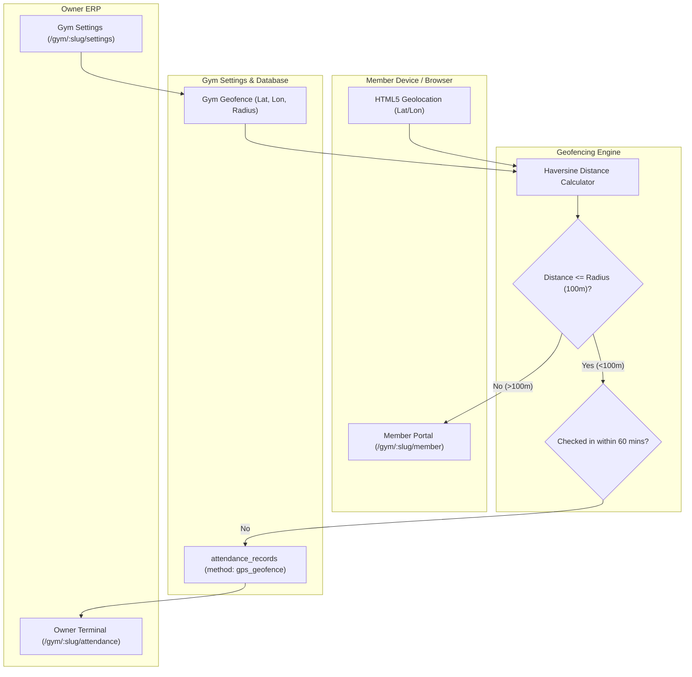

# Production Readiness, GPS Geofenced Attendance & Streamlined Roles Implementation Plan

> **For agentic workers:** REQUIRED SUB-SKILL: Use superpowers:executing-plans to implement this plan task-by-task. Steps use checkbox (`- [ ]`) syntax for tracking.

**Goal:** Transform GymOS into an immediately deliverable, production-ready commercial gym ERP by streamlining roles to Owner and Member, implementing GPS geofenced auto-attendance with real-time distance calculation, adding Razorpay & WhatsApp integration architectures, and updating the database schema and UI.

**Architecture:** 
1. Streamline RBAC to two core gym operational roles: `owner` (Full administrative ERP control) and `member` (Self-service portal, digital pass, GPS auto check-in).
2. Implement GPS Geofencing using the Haversine formula against gym coordinates (`latitude`, `longitude`, `geofence_radius_meters`). When a member is within the radius, auto-attendance triggers with anti-duplicate 60-minute lockout. Provide simulated location controls for testing.
3. Add Razorpay payment checkout integration and 1-click WhatsApp notification generators.
4. Update database migrations (`0001` and `0002`) and persistent store (`gymStore`) to support geofencing, streamlined roles, and payment links.

**Architecture Diagram:**

**Tech Stack:** React 19, TypeScript 5, Vite 6, Tailwind CSS, Lucide Icons, date-fns, Vitest, Supabase PostgreSQL 17 migrations.

**Spec:** [docs/PRD.md](file:///c:/Users/hp/OneDrive/Desktop/antigravity%20workspace/GYM_OS/docs/PRD.md) and [docs/ARCHITECTURE.md](file:///c:/Users/hp/OneDrive/Desktop/antigravity%20workspace/GYM_OS/docs/ARCHITECTURE.md)

---

## Global Constraints

- Roles within gym operations must strictly be simplified to `owner` (Gym Owner / Admin) and `member` (Gym Member).
- Attendance method `'gps_geofence'` must calculate distance accurately using the Haversine formula and enforce the 60-minute duplicate lockout.
- All code must pass strict TypeScript checks (`tsc --noEmit`) and Vite production build (`npm run build`).
- Automated tests in `tests/` must achieve 100% pass rate.
- Git commits must be created cleanly and pushed to `https://github.com/sumit07122/GYM-OS`.

## Review Focus

1. **GPS Distance Edge Case:** Distance calculation handles negative coordinates and cross-equator / cross-meridian math without NaN.
2. **Anti-Duplicate Lockout:** A member already checked in via GPS cannot check in again within 60 minutes via GPS or QR scan.
3. **Out-of-Bounds Rejection:** When GPS is beyond `geofence_radius_meters`, attendance is rejected and shows exact distance in meters/km.
4. **Role Switching Simplicity:** Top navigation features a clean, 1-click toggle between "Gym Owner ERP" and "Member Self-Service Portal".
5. **WhatsApp & Razorpay Usability:** Generates direct valid `https://wa.me/` URLs with pre-formatted Indian text and phone numbers (+91).

---

## Implementation Tasks

### Task 1: Update Types, Geolocation Engine & Streamlined RBAC

**Files:**
- Modify: `src/types/index.ts`
- Create: `src/lib/geo/distance.ts`
- Modify: `src/lib/permissions/rbac.ts`
- Create: `tests/unit/geolocation.test.ts`

- [ ] **Step 1: Write failing unit test for Haversine distance and geofence evaluation**
- [ ] **Step 2: Run test to verify it fails**
- [ ] **Step 3: Implement Haversine formula and geofence checking in `src/lib/geo/distance.ts`**
- [ ] **Step 4: Update `src/types/index.ts` with `latitude`, `longitude`, `geofence_radius_meters` and `gps_geofence` method**
- [ ] **Step 5: Simplify `src/lib/permissions/rbac.ts` to `owner` and `member`**
- [ ] **Step 6: Run tests and verify PASS**
- [ ] **Step 7: Commit changes**

### Task 2: Update Store & Database Migrations for Geofencing

**Files:**
- Modify: `supabase/migrations/0001_core_tenancy_and_auth.sql`
- Modify: `supabase/migrations/0002_members_and_attendance.sql`
- Modify: `src/lib/supabase/store.ts`
- Modify: `tests/unit/attendance_rules.test.ts`

- [ ] **Step 1: Update SQL migrations with geofence columns and `'gps_geofence'` enum value**
- [ ] **Step 2: Update `GymSettings` in `src/lib/supabase/store.ts` with default Mumbai coordinates (`19.0596`, `72.8295`, radius `100`m)**
- [ ] **Step 3: Add `checkInMemberViaGps(gymId, memberId, userLat, userLon)` method in `gymStore`**
- [ ] **Step 4: Update attendance unit test to test GPS check-in and verify PASS**
- [ ] **Step 5: Commit changes**

### Task 3: Build GPS Auto-Attendance Component & Member Portal Experience

**Files:**
- Create: `src/components/attendance/GpsAutoAttendanceCard.tsx`
- Modify: `src/pages/MemberPortal.tsx`
- Modify: `src/pages/Attendance.tsx`

- [ ] **Step 1: Create `GpsAutoAttendanceCard` component with real HTML5 geolocation + simulated toggle**
- [ ] **Step 2: Integrate card into `MemberPortal.tsx` with live distance radar and 1-click check-in**
- [ ] **Step 3: Update `Attendance.tsx` to display GPS check-ins with dedicated badge and verifier details**
- [ ] **Step 4: Test in browser and verify build**
- [ ] **Step 5: Commit changes**

### Task 4: Streamline Navigation & UI for Owner vs Member

**Files:**
- Modify: `src/components/layout/Sidebar.tsx`
- Modify: `src/components/layout/Header.tsx`
- Modify: `src/lib/tenant/context.tsx`

- [ ] **Step 1: Simplify role selector in `Sidebar.tsx` to clean "Owner / Admin" and "Member" pill**
- [ ] **Step 2: Filter navigation links cleanly based on active role (Member mode only shows Portal, Pass, and Workouts)**
- [ ] **Step 3: Verify navigation flows smoothly across all desktop and mobile viewports**
- [ ] **Step 4: Commit changes**

### Task 5: Add Geofence Configuration & Razorpay / WhatsApp Setup to Settings

**Files:**
- Modify: `src/pages/Settings.tsx`
- Modify: `src/pages/Finance.tsx`
- Create: `src/lib/communications/whatsapp.ts`

- [ ] **Step 1: Add Geofencing coordinates and radius configuration controls to `Settings.tsx`**
- [ ] **Step 2: Add Razorpay test key configuration and WhatsApp API configuration inputs**
- [ ] **Step 3: Create `src/lib/communications/whatsapp.ts` for generating 1-click WhatsApp reminder & receipt links**
- [ ] **Step 4: Add 1-click WhatsApp invoice link button to `Finance.tsx`**
- [ ] **Step 5: Commit changes**

### Task 6: Full Verification, Production Build & GitHub Push

**Files:**
- All modified and new files

- [ ] **Step 1: Run complete Vitest test suite (`npm run test`)**
- [ ] **Step 2: Run TypeScript compiler check (`tsc --noEmit`)**
- [ ] **Step 3: Run production build (`npm run build`)**
- [ ] **Step 4: Verify local dev server at `http://localhost:5173`**
- [ ] **Step 5: Push milestone commit to GitHub (`https://github.com/sumit07122/GYM-OS`)**
